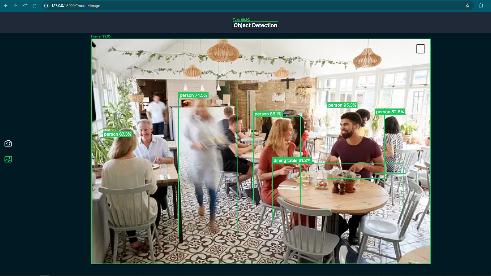

# Object Detection

The Object Detection app identifies common objects from a live camera feed or an uploaded image. Inference runs locally in the browser with TensorFlow.js and COCO-SSD; selected images and camera frames are not uploaded to an application server.



## Features

- Live camera detection with responsive bounding boxes
- Optional audio alert for a named object, such as `person` or `car`
- Image detection through file selection or drag and drop
- JPG, PNG, and WebP validation with a 10 MB upload limit
- Fast COCO-SSD detection using TensorFlow.js
- Shared, cached model loading when switching between camera and image modes
- Accessible controls, visible model state, and mobile-friendly layout

COCO-SSD recognizes the 80 object categories in the COCO dataset. It is a general object detector, not a face-recognition model. COCO includes `knife`, `baseball bat`, and `scissors`, but it does not include a generic gun or weapon class.

## Run locally

Requirements: Node.js 22.13 or newer and pnpm 11.

```bash
pnpm install
pnpm dev
```

Open [http://localhost:3000](http://localhost:3000). Camera access requires browser permission and a secure context (`localhost` is accepted by modern browsers).

## Quality checks

```bash
pnpm lint
pnpm typecheck
pnpm build
```

## Technology

- Next.js and React
- TypeScript and Tailwind CSS
- TensorFlow.js and COCO-SSD

## License

Licensed under the [MIT License](LICENSE).
